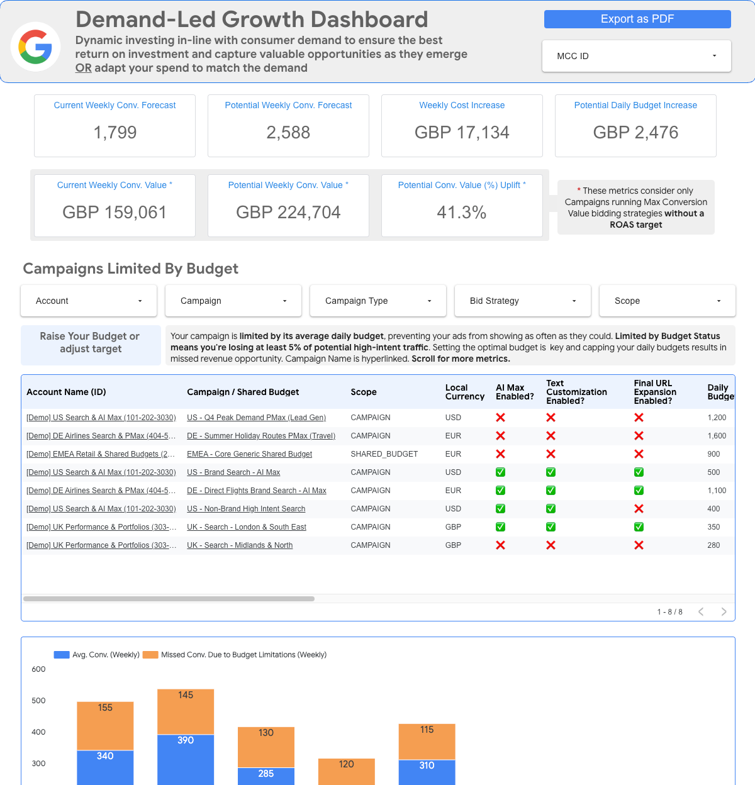
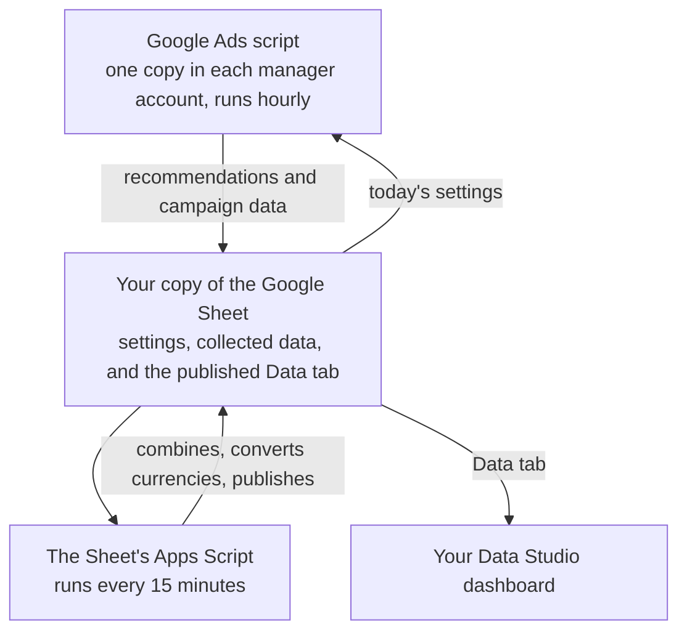

# Demand-Led Growth (DLG) Dashboard — Ads Script edition

https://github.com/google-marketing-solutions/dlg-tool

Copyright 2026 Google LLC

The DLG Dashboard shows you where your Google Ads campaigns miss out on demand because of their budgets or bidding targets. It collects Google Ads' budget and bidding recommendations from every account you choose, across up to 8 manager accounts (MCCs), and shows them in one Data Studio dashboard with the extra cost and conversions that Google Ads forecasts for each one.

You don't need a Google Cloud project or any coding: you copy a Google Sheet, paste a script into Google Ads, and create the dashboard from the Sheet's menu.

> [!NOTE]
> **Which edition do you need?**
>
> * **Ads Script edition (this repository):** runs entirely in Google Ads scripts and Google Sheets. Choose it if you want to start quickly without Google Cloud, with up to 8 manager accounts.
> * **Cloud edition:** runs on Google Cloud for larger deployments. See [`google-marketing-solutions/demand-led-growth`](https://github.com/google-marketing-solutions/demand-led-growth/).

## Contents

* [Features](#features)
* [How it works](#how-it-works)
* [Before you start](#before-you-start)
* [Set up the dashboard](#set-up-the-dashboard)
* [Upgrading from version 1](#upgrading-from-version-1)
* [Documentation](#documentation)
* [Getting help](#getting-help)
* [Contributing](#contributing)
* [License](#license)
* [Disclaimer](#disclaimer)

## Features

* **Six recommendation types.** Four budget recommendations (raise a limited budget, raise a budget for forecasted demand, raise a budget based on marginal return, and move unused budget between campaigns) and two bidding recommendations (raise a target CPA, lower a target ROAS). Each one shows the 7-day forecast from Google Ads: cost, clicks, conversions, and conversion value, with and without the change.
* **Several manager accounts in one dashboard.** Combine up to 8 MCCs and pick exactly which accounts to include. Each MCC's data updates as soon as its daily run finishes.
* **Large accounts.** The script saves its progress and continues on its next hourly run, so manager accounts with many accounts aren't limited by the 30-minute Google Ads scripts time limit.
* **Portfolio and shared-budget handling.** A recommendation for a portfolio bid strategy or shared budget appears once, with its member campaigns listed, so the dashboard never counts the same budget or forecast twice.
* **Currency conversion.** Report accounts in different currencies together in one currency of your choice, using daily exchange rates.
* **Exclude Shopping & Feed PMax.** One setting leaves out Shopping campaigns and Performance Max campaigns connected to a Merchant Center feed.
* **Campaign context.** Recent spend, conversions, CPA, ROAS, budget usage, and lost impression share for every campaign, plus links that open the campaign and the recommendation in Google Ads.
* **Read-only.** The scripts never change anything in your Google Ads accounts.

## How it works

1. In each manager account, the Google Ads script reads today's settings from the Sheet, collects the recommendations for the accounts you chose, and saves them to its own hidden tabs in the Sheet.
2. Every 15 minutes, the Sheet's Apps Script combines the data from all manager accounts, converts currencies, and publishes the result to the `Data` tab.
3. Your Data Studio dashboard reads the `Data` tab.

For the details, see [docs/architecture.md](docs/architecture.md).

## Before you start

You need:

* **Access to the template Google Sheet and Data Studio dashboard.** Ask your Google point of contact to add you to the group that can open them.
* **A Google Ads manager account (MCC)** where you can create and authorize scripts.
* **A Google account that can edit your copy of the Google Sheet.** Use the same account to authorize the Google Ads script, because the script writes to the Sheet.

## Set up the dashboard

These steps take you from the template to a working dashboard. The first data usually arrives within an hour.

1. **Copy the template.** Open the [template Google Sheet copy link](https://docs.google.com/spreadsheets/d/1CbLXHi0rS7SRLKlMWRdWnOsWxlA8eK1usoNq4Mf6Y7A/copy?resourcekey=0-tSBQgOwikfVDBHK1Rm7NnA) and click **Make a copy**.
2. **Get the Google Ads script.** In your copy, click **🚀 DLG Dashboard v2 → 📋 Copy Google Ads Script**. The first time you use the menu, Google asks you to authorize the Sheet's Apps Script; accept, then choose the menu item again. Click **📋 Copy to Clipboard**.
3. **Install the script in Google Ads.** In your manager account, go to **Tools and settings → Bulk actions → Scripts**, create a new script, and paste the code. Click **Save**, **Authorize**, and then **Preview**. Preview registers the manager account and its accounts in your Sheet.
4. **Schedule the script.** In the scripts list, set the script's frequency to **Hourly**. To add more manager accounts, repeat steps 3 and 4 in each one, using only top-level manager accounts.
5. **Choose your accounts.** Back in the Sheet, click **🚀 DLG Dashboard v2 → 🔄 Apply Config Changes Now** so your manager accounts and their accounts appear on the `Config` tab right away. Check the accounts to include and choose a **Target Currency**, then click **🔄 Apply Config Changes Now** again to save today's settings.
6. **Collect the first data.** In Google Ads, click **Run** on the script, or wait for its next hourly run. When it finishes, the `Config` tab's status shows **🟢 PUBLISHED** within 15 minutes; click **🔄 Apply Config Changes Now** to publish straight away.
7. **Create the dashboard.** Click **🚀 DLG Dashboard v2 → 📊 Create New Data Studio Dashboard**, open the link, and save the report in Data Studio. You can do this before the first data arrives; the dashboard fills in once the `Data` tab is published.
8. **Save the dashboard link.** Paste the report's URL into cell `D13` on the `Setup` tab. Anyone with the Sheet can then open it with **🚀 DLG Dashboard v2 → 🚀 Open Saved Dashboard**.

After setup, the dashboard refreshes every day by itself. To change settings during the day, edit the `Config` tab and click **🔄 Apply Config Changes Now**. For a full description of the `Config` tab and help with common problems, see [docs/operations.md](docs/operations.md).

## Upgrading from version 1

Version 2 uses a new Google Sheet and a new dashboard, so set it up as a new instance by following [Set up the dashboard](#set-up-the-dashboard). When version 2 is running, remove the version 1 script from your manager account. Your version 1 Google Sheet and dashboard aren't changed. See the [CHANGELOG](CHANGELOG.md) for what changed.

## Documentation

* [docs/operations.md](docs/operations.md): access and schedules, a reference for the `Setup` and `Config` tabs, data freshness, status messages, and troubleshooting.
* [docs/data-reference.md](docs/data-reference.md): every column in the `Data` tab, and how recommendations are combined, ranked, filtered, and converted.
* [docs/architecture.md](docs/architecture.md): how the Google Ads script and the Sheet's Apps Script work together, and why they're built this way.
* [docs/development-guide.md](docs/development-guide.md): step-by-step guides for common changes, such as adding a column or a recommendation type.
* [CHANGELOG.md](CHANGELOG.md): what changed in each version.
* [CONTRIBUTING.md](CONTRIBUTING.md): how to build, test, and contribute changes.

## Getting help

This project has no official support (see the [Disclaimer](#disclaimer)), but you can get help here:

* For access to the template, or help setting up the dashboard for your accounts, contact your Google point of contact.
* To report a bug or ask for a feature, [open an issue](https://github.com/google-marketing-solutions/dlg-tool/issues) on GitHub.

## Contributing

We welcome contributions. Before you send a pull request, sign the Google Contributor License Agreement and read [CONTRIBUTING.md](CONTRIBUTING.md), which explains how to set up the project, run the tests, and build the scripts.

## License

You are free to use, copy, modify, and distribute the DLG Dashboard under the terms of the Apache License 2.0. See the [LICENSE](LICENSE) file for details.

## Disclaimer

This is not an officially supported Google product. This project is not eligible for the [Google Open Source Software Vulnerability Rewards Program](https://bughunters.google.com/open-source-security).

This project is intended for demonstration and reference purposes only.
