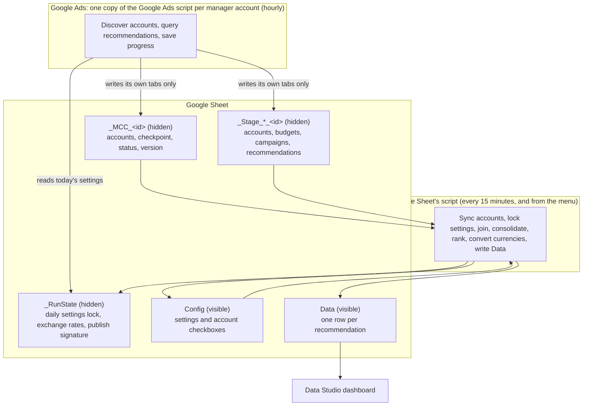
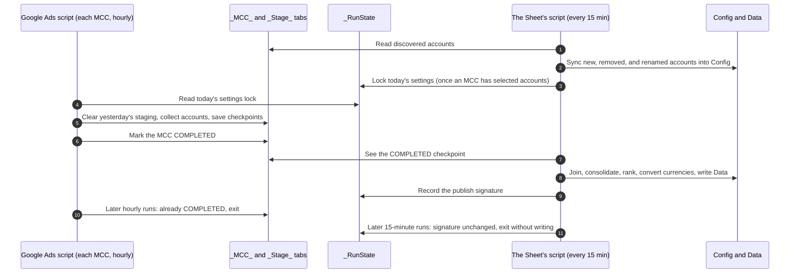

# Architecture

This document explains how the DLG Dashboard works inside, and why it's built this way. It's for developers who maintain or extend the code, and for technical operators who want to understand the data flow in depth. For step-by-step changes, see the [development guide](development-guide.md).

## Contents

1. [Overview](#1-overview)
2. [The two scripts](#2-the-two-scripts)
3. [The Google Sheet's tabs](#3-the-google-sheets-tabs)
4. [A day in the life](#4-a-day-in-the-life)
5. [Collecting data in the Google Ads script](#5-collecting-data-in-the-google-ads-script)
6. [Publishing the Data tab](#6-publishing-the-data-tab)
7. [Settings and the daily settings lock](#7-settings-and-the-daily-settings-lock)
8. [Concurrency and safety](#8-concurrency-and-safety)
9. [Build and deployment](#9-build-and-deployment)
10. [Design decisions](#10-design-decisions)
11. [Module map](#11-module-map)

## 1. Overview

The DLG Dashboard is made of two separate Apps Script programs that never call each other. They communicate only through tabs in one Google Sheet:



* The **Google Ads script** runs in each manager account (MCC), up to 8 of them. It collects recommendations and campaign data for the accounts chosen in the Sheet, and saves them to hidden tabs that belong only to its MCC.
* The **Sheet's script** is bound to the Google Sheet. It keeps the `Config` tab in sync with the discovered accounts, fixes each day's settings, and every 15 minutes combines the hidden tabs into the `Data` tab.
* **Data Studio** reads the `Data` tab.

## 2. The two scripts

| | Google Ads script | The Sheet's script |
|---|---|---|
| Source | `src/ads/` and `src/shared/` | `src/appscript/` and `src/shared/` |
| Built into | `dist/ads/Code.gs` | `dist/sheet/Code.gs` and `dist/sheet/appsscript.json` |
| Installed by | The user, who pastes it into each MCC from **📋 Copy Google Ads Script** | Copying the template Google Sheet; maintainers update the template with `npm run push:sheet` |
| Runs | Hourly, on the schedule the user sets in Google Ads | Every 15 minutes on a time-driven trigger, and when a menu item is clicked |
| Time limit | 30 minutes per run | 6 minutes per run |
| Entry points | `main` | `onOpen`, `onEdit`, `runScheduledPublish`, and one function per menu item |
| Opens the Sheet with | `SpreadsheetApp.openByUrl`, using the URL injected when the script was copied | `SpreadsheetApp.getActiveSpreadsheet` |
| Permissions | Whatever its code uses: Google Ads and Google Sheets. The person who authorizes it must be able to edit the Sheet | Pinned in the manifest: the Sheet it's bound to, menus and dialogs, and installing its own trigger |

**Why two scripts?** The Google Ads script must run inside Google Ads to call the Google Ads API, but the menu, the checkbox handling, and the 15-minute publisher need a script bound to the Sheet. A Google Ads script also can't call functions in another Apps Script project, so the two can only share data through the Sheet.

**Versions can differ.** Each MCC runs the copy of the Google Ads script that was pasted into it, while the Sheet's script comes from the template. The Google Ads script records its version in its `_MCC_<id>` tab, and the Sheet shows a warning when an MCC's version differs from the Sheet's. The JSON they exchange is versioned too (see [Concurrency and safety](#8-concurrency-and-safety)).

## 3. The Google Sheet's tabs

| Tab | Visible | Written by | Contents |
|---|---|---|---|
| `Setup` | Yes | The template and the user | Setup instructions, and the saved dashboard URL in `D13` |
| `Config` | Yes | The Sheet's script and the user | Status message (`B2`), Target Currency (`B5`), Exclude Shopping & Feed PMax (`B6`), the select-all checkbox (`A9`), the MCC table (rows 11–18, one row per MCC), and the accounts table (from row 22) |
| `Data` | Yes | The Sheet's script | Header row, the schema dummy row in row 2, then one row per recommendation. This is the tab Data Studio reads |
| `_RunState` | No | The Sheet's script | A key/value table: the daily settings lock (`DAILY_CONFIG_LOCK_<date>`), the publish signature and status (`PUBLISH_SIGNATURE_<date>`, `PUBLISH_STATUS_<date>`), and exchange rates (`FX_RATES_<date>_<target>`, `FX_LAST_GOOD_<from>_<to>`). Cell `G1` is scratch space for `GOOGLEFINANCE` |
| `_MCC_<id>` | No | That MCC's Google Ads script. The Sheet's script only clears its `CHECKPOINT` row when settings change | `MCC_META`, `CHECKPOINT` (versioned JSON), `LAST_COMPLETED_DATE`, `STATUS_MESSAGE`, `SCRIPT_VERSION`, and one `CHILD_ACCOUNT` row per discovered account |
| `_Stage_Accounts_<id>`, `_Stage_Budgets_<id>`, `_Stage_Campaigns_<id>`, `_Stage_Recs_<id>` | No | That MCC's Google Ads script | Normalized tables with today's collected data for that MCC |

`<id>` is the MCC's 10-digit customer ID without dashes. The demo data seeder also writes `_MCC_*` and `_Stage_*` tabs for its two demo MCCs.

## 4. A day in the life



1. **Registering an MCC.** When the Google Ads script runs in Preview, or before today's settings lock includes its MCC, it only discovers the MCC's accounts. It writes them to `_MCC_<id>` and stops.
2. **Syncing `Config`.** On its next run, or when **🔄 Apply Config Changes Now** is clicked, the Sheet's script copies new MCCs and accounts from the `_MCC_*` tabs into `Config`. It adds new accounts (checked if the MCC's "Select All in MCC" box is checked), removes unlinked ones, updates renamed ones, and rebuilds the Target Currency list.
3. **Locking the day's settings.** As soon as at least one MCC has a selected account, the Sheet's script saves today's settings to `_RunState` (see [Settings and the daily settings lock](#7-settings-and-the-daily-settings-lock)).
4. **Collecting.** Each MCC's Google Ads script reads the lock, clears yesterday's staging data at the start of the day, collects the selected accounts in batches, and marks the MCC `COMPLETED` when every account is done. Large MCCs take several hourly runs (see [Collecting data](#5-collecting-data-in-the-google-ads-script)).
5. **Publishing.** On its next run after an MCC completes, the Sheet's script publishes that MCC's data to `Data`. MCCs that haven't finished yet keep their previous rows, marked stale (see [Publishing](#6-publishing-the-data-tab)).
6. **Idle for the rest of the day.** Later hourly runs of the Google Ads script see that today is `COMPLETED` and exit after a few reads. Later 15-minute runs of the Sheet's script find nothing changed and exit without writing.
7. **The next day,** the cycle starts again. Until an MCC finishes the new day's run, its rows show as stale.

Accounts linked or renamed in Google Ads after an MCC has completed for the day are picked up the next day: once an MCC has completed, its later runs that day stop before discovering accounts.

## 5. Collecting data in the Google Ads script

The run is coordinated by `runAdsScriptOrchestrator` in `src/ads/orchestrator.ts`.

**Each run:**

1. Read today's settings lock from `_RunState`. If today is already `COMPLETED` for this MCC, stop.
2. Discover the MCC's accounts with `AdsManagerApp.accounts()`. In Preview, or when the lock doesn't include this MCC yet, write the discovery to `_MCC_<id>` and stop.
3. Load today's checkpoint. If no account has been processed or failed today, clear this MCC's staging tabs.
4. Process each selected account not yet completed, one at a time.
5. When every selected account is done or given up, mark the MCC `COMPLETED`.

**For each account** (`src/ads/gaql/` and `src/ads/processors/recommendations.ts`):

1. Query the six supported recommendation types. If there are none, the account is done.
2. Query only the campaigns and budgets those recommendations refer to: campaign settings (enabled campaigns only), 30-day performance, yesterday's cost, 7-day cost, and, for `MOVE_UNUSED_BUDGET`, the source budget and its campaigns. Resource names are sent in batches of 500.
3. Apply the **Exclude Shopping & Feed PMax** setting: Shopping campaigns are excluded in the query, and Performance Max campaigns with a Merchant Center ID are dropped afterwards. A recommendation is dropped if any of its campaigns, or any source campaign of a `MOVE_UNUSED_BUDGET` recommendation, is excluded.
4. Build normalized rows: one per account, budget, campaign, and recommendation–campaign pair. Each campaign and budget is stored once, however many recommendations refer to it.

**Staying within the 30-minute limit:**

* Staged rows and the checkpoint are saved every 25 accounts or 500 recommendations (`FLUSH_EVERY_N_ACCOUNTS`, `FLUSH_EVERY_N_RECS`).
* Before each account, the script checks the time left. With less than 4 minutes (`MIN_REMAINING_TIME_SECONDS`), it saves and stops; the next hourly run continues from the next account.

**Failures.** Each account runs in its own `try`/`catch`. A failed account is recorded in the checkpoint with its error and attempt count, and the MCC stays `IN_PROGRESS` so the next run retries it without clearing today's staging. After 3 failed runs (`MAX_ACCOUNT_ATTEMPTS`), the account is given up for the day, and the MCC can complete. The publisher keeps that account's previous rows with a warning.

**What the script never does:** read or write `Config`, `Data`, or `_RunState` (it only reads the lock), write another MCC's tabs, take the document lock, or change anything in Google Ads.

## 6. Publishing the Data tab

`publishFromStagingToData` in `src/appscript/publisher.ts` runs every 15 minutes (`runScheduledPublish`), and with `force` after **🔄 Apply Config Changes Now** or the demo seeder. The whole publish runs under the document lock.

1. **Sync `Config`** from the `_MCC_*` tabs. This writes nothing when nothing has changed.
2. **Plan.** Read today's lock (or create it, if an MCC has selected accounts and there's no lock yet). An MCC is **ready** when its checkpoint is `COMPLETED` for today.
3. **Decide whether to publish.** Compute a signature of today's date, the settings, and each MCC's selected accounts, readiness, last completed date, and failed accounts. If it matches the last publish, stop without writing anything. Also stop if no MCC is ready and `Data` is empty, so a half-finished first day never produces an empty `Data` tab.
4. **Build rows for each active MCC:**
   * **Ready MCCs:** read the four staging tabs and build fresh rows:
     1. **Join** the staged tables into report rows and calculate derived metrics (`joiner.ts`).
     2. **Consolidate** portfolio and shared-budget recommendations into one row each (`consolidator.ts`, `entity-keys.ts`).
     3. **Rank** recommendations per campaign, portfolio, or shared budget (`ranking.ts`).
   * **Accounts given up today:** keep their previous `Data` rows, with a warning in `mccSyncStatus`.
   * **MCCs not finished today:** keep their previous `Data` rows, marked `WARNING: Stale snapshot from <date>`. If `Data` has no rows for the MCC and today's run hasn't started, the previous completed run's staging data is used instead.
5. **Convert currencies** once for all rows (`fx-rates.ts`). Rates come from today's cache, then a live `GOOGLEFINANCE` formula in `_RunState!G1`, then the last good rate. If none is available, the converted columns are left empty rather than guessing a rate of 1. Only the six `*Global` columns are converted.
6. **Write `Data`** (`sheets/data-writer.ts`): the header, the schema dummy row, and the rows, in 1,000-row chunks, with number formats applied before values. The grid is trimmed to fit.
7. **Record** the signature and status in `_RunState`, and update the `Config` status message, including warnings for stale MCCs, failed accounts, accounts under more than one MCC, and outdated Google Ads script copies.

The meaning of each column, and the consolidation, ranking, and filtering rules, are described in [data-reference.md](data-reference.md).

## 7. Settings and the daily settings lock

The Google Ads script never reads `Config`. Instead, the Sheet's script saves the day's settings to `_RunState` as `DAILY_CONFIG_LOCK_<date>`: the Target Currency, the Exclude Shopping & Feed PMax setting, and the selected accounts of each MCC.

* The lock is created the first time the Sheet's script runs on a new day with at least one selected account. Edits to `Config` later that day don't change it, so every MCC collects with the same settings, even when their runs are hours apart.
* An MCC that isn't in today's lock (for example, one registered after the lock was created) only registers its accounts until the next day, or until **🔄 Apply Config Changes Now** creates a new lock that includes it.
* **🔄 Apply Config Changes Now** (`applyConfigChangesNow` in `sheet-ui.ts`) applies edits immediately. It clears today's lock, exchange-rate cache, and publish signature, and then resets only what the change requires:
  * **Target Currency or unchecked accounts:** nothing else. The data already collected is republished.
  * **Exclude Shopping & Feed PMax changed:** every active MCC's checkpoint, because the Google Ads script applies that filter while collecting.
  * **Newly checked accounts that a completed MCC didn't collect:** that MCC's checkpoint only.

  Reset MCCs show as stale until their next hourly run. The publish that follows creates a new lock from the current `Config`.

**Dates.** The Sheet's script uses the Google Sheet's time zone. The Google Ads script uses the time zone injected when it was copied, so if the Sheet's time zone changes, the script must be copied again for both to agree on what "today" is.

## 8. Concurrency and safety

The scripts use these safeguards to keep simultaneous runs, version differences, and unexpected Sheet content from corrupting data:

* **One writer per tab.** Apps Script locks can't be shared between the Google Ads script and the Sheet's script, or between copies of the Google Ads script in different MCCs. Instead, each MCC writes only tabs named after its own ID, and every shared tab is written only by the Sheet's script. Two MCCs running at the same moment never write the same tab.
* **The document lock.** Publishing, **🔄 Apply Config Changes Now**, the demo seeder, and every write to `Data` or `_RunState` run inside `withSheetLock` (`run-state.ts`), which takes `LockService.getDocumentLock()` for up to 30 seconds.
  * It stops the 15-minute trigger and a menu click from writing at the same time.
  * It's re-entrant within one run, and pending writes are flushed before it's released.
  * The `onEdit` checkbox handler doesn't take the lock; it only writes checkbox cells on the `Config` tab.
* **`_RunState` compaction.** Every `_RunState` write reads the whole table, drops date-specific keys from earlier days, applies the change, and writes the table back in one call. `FX_LAST_GOOD_*` keys are kept across days.
* **The cross-script contract** (`src/shared/contract.ts`). The checkpoint and the daily lock are JSON with a `schemaVersion`.
  * Readers check the shape and the version instead of trusting the data. When either is wrong, they ignore it and log that the Google Ads script must be copied again.
  * An ignored checkpoint makes the MCC start its day again, which is safe because staging writes are idempotent.
* **Safe cell writing:**
  * Text cells get the `@` (plain text) format before values are written, so IDs keep their leading zeros and aren't turned into dates or numbers.
  * Values that start with `=`, `+`, `-`, `@`, a tab, or a carriage return are prefixed with `'`, so names from Google Ads can never run as formulas. The prefix is removed when reading back.
* **Reading by header name.** `Data` and staging tabs are read by header name, not position, so older layouts load safely. `Data` is still *written* by position, because Data Studio reads it by position; see the append-only rule in [CONTRIBUTING.md](../CONTRIBUTING.md#coding-guidelines).
* **`Config` layout guard.** `assertConfigLayout` stops the scripts if the `Config` table headers have moved, rather than reading or writing the wrong cells.
* **The schema dummy row.** Row 2 of `Data` always holds a typed placeholder value in every column (`accountName` = `!!! SCHEMA DEFINITION (FILTER ME OUT)`), so Data Studio detects the right type even for columns that are empty in every real row that day. It's never counted or republished, and dashboards filter it out.
* **One publisher trigger per Sheet.** `ScriptApp.getProjectTriggers()` only returns the current user's triggers, so the Sheet records a heartbeat in a document property each time the publisher runs. A new trigger is installed (when a user opens **📋 Copy Google Ads Script** or clicks **🔄 Apply Config Changes Now**) only if that user has none and no publisher has run in the last 45 minutes.

## 9. Build and deployment

`scripts/build.mjs` runs esbuild twice:

1. **The Google Ads script:** bundles `src/ads/main.ts` into a single function scope (`DlgAdsBundle`) with a banner that declares the `SPREADSHEET_URL` and `SPREADSHEET_TIMEZONE` placeholders, and a footer that exposes `main()`.
2. **The Sheet's script:** bundles `src/appscript/sheet-ui.ts` the same way (`DlgSheetBundle`), **embedding the whole Google Ads script as a string**. The footer exposes `onOpen`, `onEdit`, `runScheduledPublish`, and the menu functions, because Apps Script can only call top-level functions. The build also writes the manifest with the pinned permissions.

Both bundles get the `package.json` version, which the Google Ads script records in `_MCC_<id>` and the Sheet compares with its own.

When a user clicks **📋 Copy Google Ads Script**, the Sheet's script replaces the placeholders in the embedded script with the Sheet's URL and time zone and shows the result to copy. That's how each MCC's script knows which Sheet to write to.

`npm run push:sheet` uploads `dist/sheet/` to the Apps Script project in `.clasp.json`: the template's project for releases, or a contributor's own copy for testing.

## 10. Design decisions

| Decision | Why |
|---|---|
| **No Google Cloud project.** Everything runs in Google Ads scripts and Google Sheets | The tool should be usable by marketing teams without any Cloud setup. The Cloud edition covers larger deployments |
| **Each MCC writes only its own tabs** | Scripts in different MCCs can't share a lock, so separate tabs are the only way to keep simultaneous runs from overwriting each other |
| **Normalized staging tables** | A Google Sheet holds at most 10 million cells. Storing each account, budget, and campaign once, instead of repeating them on every recommendation row, keeps staging small. The Sheet's script joins them back when publishing |
| **Checkpoint and resume** | Google Ads scripts stop after 30 minutes. Saving progress lets an MCC of any size finish over several hourly runs without losing work |
| **Publish from the Sheet every 15 minutes** | A Google Ads script can't start the Sheet's script, so the Sheet polls. The publish signature makes idle runs read-only, so polling costs almost nothing |
| **Lock settings once a day** | MCCs collect at different times; a lock means they all use the same accounts and filters, and mid-day edits can't produce a mix of settings in one day's data |
| **Keep stale data instead of removing it** | A dashboard with yesterday's numbers, clearly marked, is more useful than one with an MCC missing while its run finishes |
| **Consolidate portfolios and shared budgets** | Google Ads reports the whole portfolio's or shared budget's budget and forecast on every member campaign. One row per portfolio or budget stops dashboards from counting it once per campaign |
| **Append-only `Data` columns and a dummy row** | Data Studio reads Sheets columns by position and detects types from values. Fixed positions and a typed row 2 keep existing dashboards working |
| **At most 8 MCCs per Sheet** | The `Config` tab has 8 MCC rows. The limit also keeps cell usage and publish time well within Google Sheets' limits |
| **Minimal permissions** | The Sheet's script can only access its own Sheet. Users and administrators trust a tool more when it asks for little |

## 11. Module map

```text
src/
├── ads/                           Google Ads script (dist/ads/Code.gs)
│   ├── main.ts                    Entry point: checks the injected Sheet URL and time zone
│   ├── orchestrator.ts            Discovery, checkpoints, batching, retries, completion
│   ├── gaql/
│   │   ├── queries.ts             GAQL query builders and 500-item batching
│   │   └── fetcher.ts             Runs queries, converts results, Shopping/PMax filter
│   └── processors/
│       └── recommendations.ts     Builds staged rows: forecasts, targets, source budgets
├── appscript/                     The Sheet's script (dist/sheet/Code.gs)
│   ├── sheet-ui.ts                Menu, dialogs, checkboxes, trigger, Apply Config Changes Now
│   ├── publisher.ts               The publish pipeline
│   ├── config-sheet.ts            Setup and Config tabs: layout, settings, account sync
│   ├── run-state.ts               _RunState, the document lock, the daily settings lock
│   ├── fx-rates.ts                Exchange rates and *Global columns
│   ├── demo-seed.ts               Demo data (off unless DLG_ENABLE_DEMO_TOOLS is set)
│   ├── processors/
│   │   ├── joiner.ts              Joins staged tables, calculates derived metrics
│   │   ├── consolidator.ts        Portfolio and shared-budget consolidation
│   │   ├── entity-keys.ts         Keys that identify portfolios across accounts
│   │   ├── ranking.ts             recommendationNumber
│   │   └── ads-ui-urls.ts         Links to campaigns and recommendations in Google Ads
│   └── sheets/
│       └── data-writer.ts         Writes and reads the Data tab
└── shared/                        Used by both scripts
    ├── types.ts                   Report, staging, and settings types
    ├── schema.ts                  Data tab columns, formats, and the dummy row
    ├── contract.ts                Versioned JSON exchanged by the two scripts
    ├── version.ts                 Build version
    ├── sheets/
    │   ├── sheet-utils.ts         Sheet helpers, safe cell writing, _RunState reads
    │   ├── mcc-state.ts           _MCC_<id> tabs: discovery, checkpoint, status
    │   └── staging-writer.ts      _Stage_*_<id> tabs: write, read, clear
    └── utils/
        ├── base64.ts              Decodes recommendation IDs for Google Ads links
        ├── cid.ts                 Customer ID formatting
        ├── currency.ts            Currency code validation
        └── date.ts                Dates in the Sheet's time zone
scripts/
├── build.mjs                      Builds both bundles and the manifest
└── check-clasp.mjs                Stops push:sheet unless .clasp.json targets dist/sheet
test/                              Vitest tests and Apps Script fakes (test/mocks/)
```
